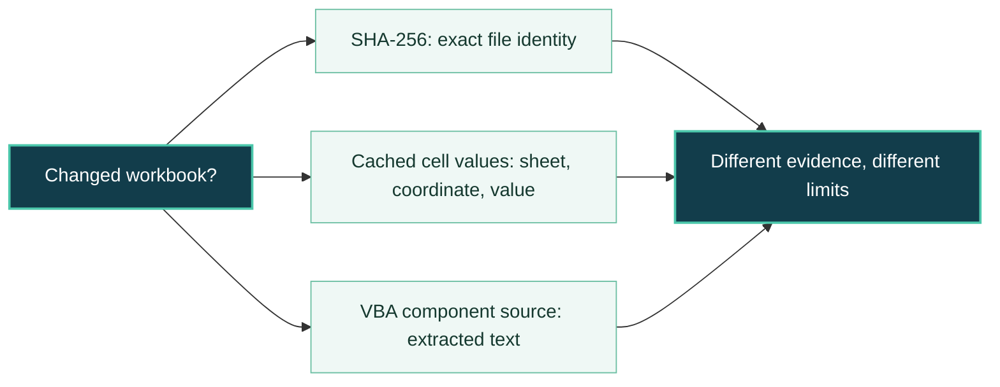
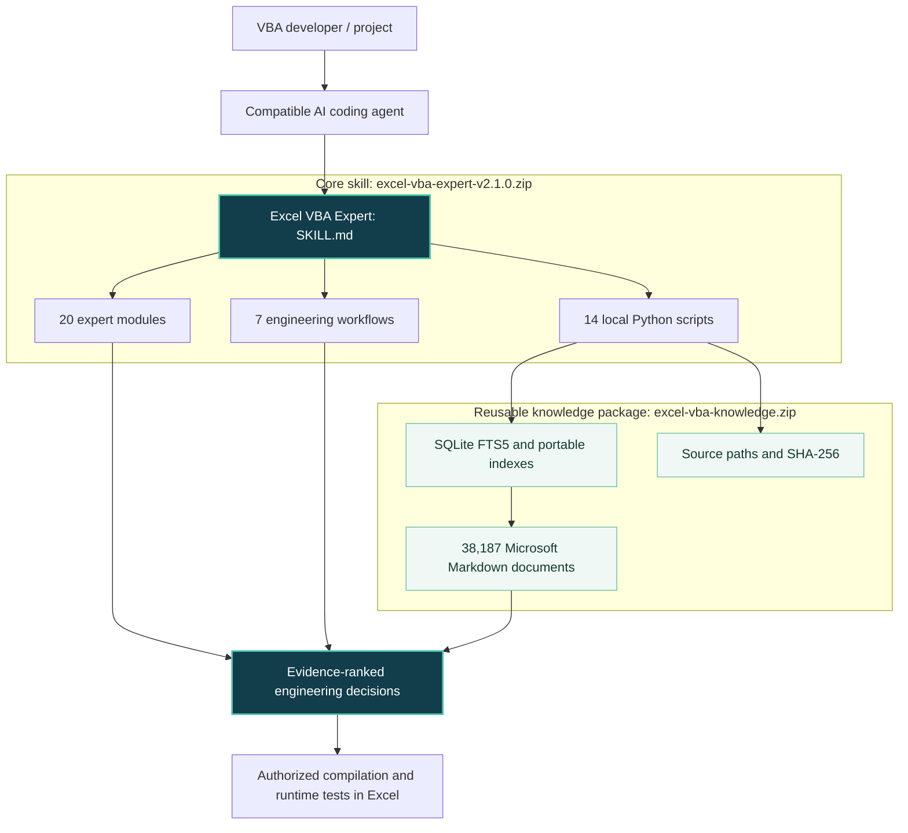

<p align="center">
  
</p>

<h1 align="center">Excel VBA Expert</h1>
<p align="center"><strong>Source-backed VBA engineering. Evidence before assumptions.</strong></p>
<p align="center">An offline-first <strong>AI Agent Skill</strong> for developing, debugging, reviewing, refactoring and maintaining real-world Microsoft Excel VBA applications.</p>

<p align="center">
  <a href="https://github.com/cycu767/excel-vba-expert/releases/tag/v2.1.0"></a>
  
  
  
  
  
</p>
<p align="center">
  <a href="https://github.com/cycu767/excel-vba-expert/releases/latest">Latest release</a>
  &nbsp; | &nbsp; <a href="#whats-new-in-v210">What's new</a>
  &nbsp; | &nbsp; <a href="#quick-start">Quick start</a>
  &nbsp; | &nbsp; <a href="#evidence-and-limitations">Evidence &amp; limitations</a>
</p>

---

> **AI can write VBA. Reliable engineering also means knowing exactly what changed, what was tested, and what remains unverified.**

Excel VBA Expert gives compatible AI coding agents task-specific workflows, original-source Microsoft API lookup and safe offline inspection utilities. It is **not** an Excel add-in, an autonomous agent or a substitute for testing code in Microsoft Excel.

## What's new in v2.1.0

Version **2.1.0** builds on the public **v2.0.2** release with stronger evidence-oriented engineering and two new read-only comparison tools.

| New capability | What it answers | Tool or reference |
|---|---|---|
| **Workbook value comparison** | Did cached cell values change outside the intended sheets and coordinates? | [`compare_workbook_values.py`](scripts/compare_workbook_values.py) |
| **VBA source comparison** | Is the decompressed VBA component source identical even if Excel reserialized the binary project? | [`compare_vba_source.py`](scripts/compare_vba_source.py) |
| **Proofs that cannot pass vacuously** | Did the verifier actually read meaningful data and detect a known negative case? | [`testing-validation.md`](references/testing-validation.md) |
| **Long-running agent conduct** | How do we preserve the reference state, work in stages and report only what was proved? | [`agent-conduct.md`](references/agent-conduct.md) |
| **Stronger VBA guidance** | How do we avoid unsafe array bounds, ambiguous macro invocation, precedence errors and dependency-order bugs? | [`vba-language.md`](references/vba-language.md), [`excel-object-model.md`](references/excel-object-model.md) |

Both new tools use **Python 3.10+ standard library only**. They read `.xlsx`/`.xlsm` packages offline; they do not open Excel, execute VBA or request Trust Center changes.

### Three distinct integrity questions



A file hash does not identify *which* worksheet changed. Equal cached values do not prove formula equality, formatting equality or recalculation correctness. Equal VBA source does not prove identical UserForm designer data, references or compiled behavior. The tools state their comparison scope explicitly.

## At a glance

| Capability | Included |
|---|---|
| **Microsoft documentation offline** | 38,187 full Markdown documents from a preserved `MicrosoftDocs/VBA-Docs` snapshot, with local search and source-integrity checking. |
| **Namespace-aware API preflight** | Evidence lookup for VBA, Excel, MSForms, Office and VBIDE rather than guessing which object owns a method or property. |
| **20 expert modules** | Focused references for language rules, Excel objects, MSForms, COM, security, deployment, testing, and agent conduct. |
| **7 engineering workflows** | Develop, debug, review, refactor, test, UserForm audit and COM troubleshooting. |
| **14 Python scripts** | Inspection, documentation retrieval, API preflight, and read-only comparisons. |
| **Conservative execution policy** | Read-only by default; production workbooks and Excel automation require explicit authorization. |

## Architecture



**Two packages, one installation.** The lightweight skill and the reusable Microsoft knowledge snapshot are installed side by side. **v2.1.0 does not require rebuilding or redownloading an already verified knowledge package.**

## Inspect changes without launching Excel

```powershell
$skill = Join-Path $HOME '.copilot\skills\excel-vba-expert'

# What cached cell values differ? Reports sheet/coordinate scope.
python "$skill\scripts\compare_workbook_values.py" '.\before.xlsm' '.\after.xlsm'

# Are the decompressed VBA module sources identical?
python "$skill\scripts\compare_vba_source.py" '.\before.xlsm' '.\after.xlsm'

# Inspect a component inventory without opening the workbook.
python "$skill\scripts\compare_vba_source.py" '.\after.xlsm' --list
```

The comparison commands use exit codes: **0** = equal in the stated scope, **1** = differences found, **2** = invalid input or format/usage error. They do not claim to validate all workbook features or the behavior of any macro.

## API verification

Before trusting an uncertain VBA API, identify its owning namespace, search the local source and read the original Microsoft page.

```powershell
$skill = Join-Path $HOME '.copilot\skills\excel-vba-expert'

# An MSForms property that should not be assumed without evidence.
python "$skill\scripts\api_preflight.py" --namespace msforms --symbol ListBox.ItemHeight

# A documented Excel method.
python "$skill\scripts\api_preflight.py" --namespace excel --symbol Range.Find
python "$skill\scripts\offline_docs.py" read 'api/Excel.Range.Find.md' --expand-includes
```

A search hit is not a proof that a given runtime object supports the member. The agent must confirm ownership, syntax, parameters and remarks in the applicable source. See [API namespace preflight](references/api-namespace-preflight.md) and the [five-library audit](FIVE-LIBRARY-AUDIT.md).

## Quick start

### 1. Download the packages

- Core: [`excel-vba-expert-v2.1.0.zip`](https://github.com/cycu767/excel-vba-expert/releases/download/v2.1.0/excel-vba-expert-v2.1.0.zip) from the new release.
- Companion knowledge archive: [`excel-vba-knowledge.zip`](https://github.com/cycu767/excel-vba-expert/releases/tag/v2.0.2) from the **v2.0.2** release (unchanged and reusable).

The core ZIP is sufficient to read the instructions and run the new comparison tools. The knowledge package is needed for the complete offline Microsoft documentation search experience.

### 2. Install on Windows (PowerShell)

Requires **Python 3.10+** with SQLite FTS5 for the documentation index. No `pip` packages are needed for the bundled tools.

Open PowerShell in the directory containing the downloaded core ZIP and, for a fresh installation, the knowledge ZIP:

```powershell
$ErrorActionPreference = 'Stop'
$base = Join-Path $HOME '.copilot\skills'
$skill = Join-Path $base 'excel-vba-expert'
$kb = Join-Path $base 'excel-vba-expert-knowledge'
$backup = Join-Path $HOME ('.copilot\skill-backups\vba-' + (Get-Date -Format 'yyyyMMdd-HHmmss'))

if (-not (Test-Path -LiteralPath '.\excel-vba-expert-v2.1.0.zip' -PathType Leaf)) {
    throw 'Missing excel-vba-expert-v2.1.0.zip'
}
if (-not (Test-Path -LiteralPath $kb) -and -not (Test-Path -LiteralPath '.\excel-vba-knowledge.zip' -PathType Leaf)) {
    throw 'Download the companion knowledge ZIP for a fresh installation.'
}

New-Item -ItemType Directory -Force -Path $base | Out-Null
if (Test-Path -LiteralPath $skill) {
    New-Item -ItemType Directory -Force -Path $backup | Out-Null
    Move-Item -LiteralPath $skill -Destination (Join-Path $backup 'excel-vba-expert')
}
Expand-Archive -LiteralPath '.\excel-vba-expert-v2.1.0.zip' -DestinationPath $base
if (-not (Test-Path -LiteralPath $kb)) {
    Expand-Archive -LiteralPath '.\excel-vba-knowledge.zip' -DestinationPath $base
}
python "$skill\scripts\validate_skill.py" --root $skill
if ($LASTEXITCODE -ne 0) { throw 'Skill validation failed; restore the backup.' }
python "$skill\scripts\offline_docs.py" verify
if ($LASTEXITCODE -ne 0) { throw 'Knowledge verification failed; restore or repair the knowledge package.' }
```

The backup is outside the active skills folder. Preserve it until validation succeeds. The knowledge archive contains its own top-level `excel-vba-expert-knowledge` folder, just as the core archive contains `excel-vba-expert`.

Expected layout:

```text
~/.copilot/skills/
|-- excel-vba-expert/
|   |-- SKILL.md
|   |-- references/
|   |-- scripts/
|   `-- workflows/
`-- excel-vba-expert-knowledge/
    |-- manifest.json
    |-- index.sqlite
    `-- repository/
```

`.copilot/skills` is an example for compatible coding clients, not a universal registration location. Each agent's skill discovery rules may differ.

### 3. Search documentation locally

```powershell
$skill = Join-Path $HOME '.copilot\skills\excel-vba-expert'
python "$skill\scripts\offline_docs.py" status
python "$skill\scripts\offline_docs.py" search 'Range.Find' --exact --json
python "$skill\scripts\offline_docs.py" read 'api/Excel.Range.Find.md' --expand-includes
```

### 4. Ask your agent to use it

> Use the **excel-vba-expert** skill. Inspect my VBA project read-only first. Verify uncertain Excel/MSForms APIs against the local Microsoft source. State what was checked, what was not checked, and which tests actually ran. Do not open Excel, execute macros, modify my files or change security settings without my permission.

## What it helps with

| Task | Main focus |
|---|---|
| **Develop** | New macro features, object-model contracts, events, charts, data operations. |
| **Debug** | Compile/runtime failures, event loops, type problems and state restoration. |
| **Refactor** | Legacy VBA, dependency analysis, preserved behavior and controlled rollout. |
| **UserForms / MSForms** | Design and events, FRM/FRX resources, MSForms-specific properties. |
| **Excel COM and interop** | Instance ownership, bitness, cleanup and Windows API declarations. |
| **Verify** | Read-only VBA source comparison, cell-value deltas, non-vacuous regression checks. |

See the [task workflows](workflows/), [expert references](references/) and the [skill entrypoint](SKILL.md).

## Evidence and limitations

| Evidence | Establishes | Does not establish |
|---|---|---|
| **SHA-256** | Exact identity of a file's bytes. | The location or meaning of a difference. |
| **Cached cell comparison** | Equality/differences of available cached values, with worksheet coordinates. | Recalculated formula results, formulas, styles, charts or VBA. |
| **VBA source comparison** | Equality/differences of extracted component source text. | Designer resources, project references, compile or runtime results. |
| **Unit tests** | Behavior of tested Python code and stated fixtures. | Universal MS-OVBA compliance or Excel macro correctness. |
| **Excel execution** | Behavior observed in the specifically authorized environment. | Universal compatibility across Office versions or all workbooks. |

**v2.1.0 verification:** the maintainer's Windows acceptance reported **156 Python tests passed (1 skipped)**, **31 comparison-tool tests**, a passing 94-entry integrity manifest, and cross-checking extracted source against an independent reader on two related samples. This does **not** certify every MS-OVBA variant, live agent behavior or actual VBA compilation/execution. The bundled scenario definitions are test contracts, not completed live-agent evaluations.

The knowledge package is an offline snapshot, not a promise of up-to-date coverage for every Office API. Offline documentation retrieval does not make the AI model itself run offline.

Read [limitations](LIMITATIONS.md), [testing guidance](references/testing-validation.md), [acceptance](ACCEPTANCE.md) and [offline verification](OFFLINE-VERIFICATION.md).

## Sources, licensing and attribution

The knowledge corpus is derived from [MicrosoftDocs/VBA-Docs](https://github.com/MicrosoftDocs/VBA-Docs), retaining original source paths, notices and licenses. Microsoft documentation is licensed under **CC BY 4.0**; original project code and prose have their respective terms described in [LICENSES.md](LICENSES.md). Do not assume a single license covers the entire knowledge package.

This independent community project is not affiliated with, sponsored by or endorsed by Microsoft.

---
<p align="center"><strong>Less guessing. More evidence. Better VBA.</strong></p>
<p align="center"><a href="https://github.com/cycu767/excel-vba-expert/releases">Releases</a> &nbsp;|&nbsp; <a href="CHANGELOG.md">Changelog</a> &nbsp;|&nbsp; <a href="https://github.com/cycu767/excel-vba-expert/issues">Report an issue</a></p>
