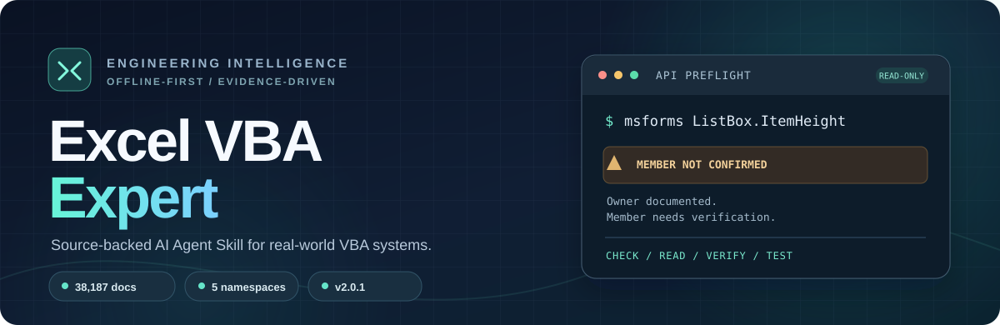
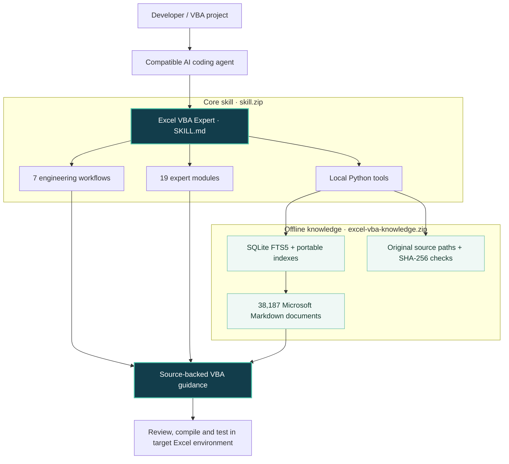
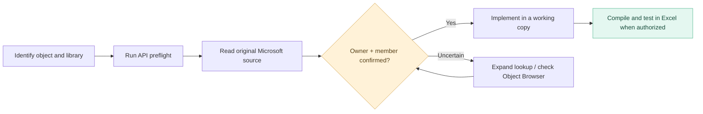

<p align="center">
  
</p>

<h1 align="center">Excel VBA Expert</h1>

<p align="center"><strong>Source-backed VBA engineering for AI coding agents.</strong></p>

<p align="center">A practical, offline-first <strong>AI Agent Skill</strong> for developing, debugging, reviewing, refactoring, and maintaining Microsoft Excel VBA applications.</p>

<p align="center">
  <a href="https://github.com/cycu767/excel-vba-expert/releases/tag/v2.0.1"></a>
  
  
  
  
  
</p>

<p align="center">
  <a href="https://github.com/cycu767/excel-vba-expert/releases/latest">Get the latest release</a>
  &nbsp;·&nbsp; <a href="#quick-start">Quick start</a>
  &nbsp;·&nbsp; <a href="#api-verification">API verification</a>
  &nbsp;·&nbsp; <a href="#documentation-and-evidence">Documentation</a>
</p>

---

> **The idea:** AI can write VBA quickly. Reliable VBA engineering also requires the *right object model*, documented API contracts, careful changes, and evidence that the code actually works.

Excel VBA Expert equips a compatible AI coding agent with a structured engineering workflow, specialized reference material, and local tools for searching and reading Microsoft documentation. It is **not** a standalone AI model, an Excel add-in, or a substitute for compiling and testing VBA in Excel.

## At a glance

| | Capability | What it provides |
|:--:|---|---|
| 📚 | **Complete local documentation snapshot** | 38,187 Markdown documents from the supplied `MicrosoftDocs/VBA-Docs` snapshot, with full-source reading, search, and integrity checks. |
| 🧭 | **Namespace-aware API preflight** | Checks source evidence for **VBA, Excel, MSForms, Office, and VBIDE** before using uncertain members. |
| 🧩 | **19 expert modules** | Targeted engineering guidance on VBA, Excel's object model, UserForms, events, COM, Windows APIs, testing, and more. |
| 🔁 | **7 engineering workflows** | Develop, debug, review, refactor, test, audit UserForms, and troubleshoot COM. |
| 🛡️ | **Safety by design** | Read-only investigation first, explicit authorization for changes, working copies, and separation of documentation from runtime evidence. |
| 🔌 | **Agent-friendly installation** | A portable skill plus a separate, reusable offline knowledge package. No hosted search service required. |

## Why it exists

VBA has several overlapping object models. An API name that exists in one library or host may not exist in another. For example, .NET WinForms and MSForms both have list controls, but their properties are **not interchangeable**.

A conventional documentation search may find a related page and still leave a crucial question unanswered: *does this specific object actually own this member?*

**Excel VBA Expert addresses that gap with a source-verification workflow — not by pretending every lookup is a compiler.**

| Risk | Engineering response |
|---|---|
| Confusing Excel, MSForms, Office, VBIDE, or VBA language APIs | Identify the owning namespace before searching. |
| Treating a keyword hit as proof of a supported member | Run namespace-aware preflight, then read the original source. |
| Inventing behavior when documentation is incomplete | Report the source gap or uncertainty explicitly. |
| Changing business-critical workbooks without safeguards | Inspect first; use a working copy and a recoverable change plan. |
| Equating documentation lookup with tested code | Record documentation, static review, compilation, and runtime results separately. |

## Architecture



**Two packages, one installation.** The code, workflows, and agent instructions remain small; the larger Microsoft documentation snapshot lives alongside the skill and does not need to be rebuilt or downloaded again for a v2.0.1 core-skill upgrade.

## API verification

The v2.0.1 release introduces [`api_preflight.py`](scripts/api_preflight.py), a read-only helper that looks for documentation evidence *within the specified API namespace*.



### A real example: an uncertain MSForms property

```powershell
$skill = Join-Path $HOME '.copilot\skills\excel-vba-expert'
python "$skill\scripts\api_preflight.py" --namespace msforms --symbol ListBox.ItemHeight
```

Representative result:

```text
msforms :: ListBox.ItemHeight
MEMBER_NOT_CONFIRMED_OWNER_ONLY
```

The ListBox owner's documentation is discoverable, but the requested member is **not established for that owner by the source**. This is a reason to stop and investigate — **not** a claim that the helper has proved universal nonexistence.

Compare that with a documented Excel method:

```powershell
python "$skill\scripts\api_preflight.py" --namespace excel --symbol Range.Find
python "$skill\scripts\offline_docs.py" read 'api/Excel.Range.Find.md' --expand-includes
```

The preflight can locate member documentation, but the agent must still verify object ownership, parameters, applicability, and relevant remarks in the original document.

### Five supported namespaces

| Namespace | Examples | Watch out for |
|---|---|---|
| **VBA** | `Split`, `InStr`, `Collection` | Language APIs are not the same as external Scripting Runtime members. |
| **Excel** | `Workbook.Save`, `Range.Find`, `Worksheet.Change` | Native Excel objects are not legacy Microsoft Graph objects. |
| **MSForms** | `UserForm`, `ListBox`, `TextBox` | Access and .NET WinForms members cannot be assumed to exist in MSForms. |
| **Office** | `FileDialog`, `CommandBars` | Shared Office APIs may differ from application-specific objects. |
| **VBIDE** | `VBProject`, `VBComponent`, `CodeModule` | Source pages are often grouped; project access can be restricted by policy. |

**Evidence statuses matter:** `SOURCE_DOCUMENT_FOUND` is not the same as a verified member contract, and `CANDIDATES_REQUIRE_MEMBER_VERIFICATION` is not approval. See the [API ownership and preflight guide](references/api-namespace-preflight.md) and [five-library audit](FIVE-LIBRARY-AUDIT.md).

## Quick start

### 1. Download the two release assets

Go to **[Releases](https://github.com/cycu767/excel-vba-expert/releases/latest)** and download:

| Archive | Purpose |
|---|---|
| **`skill.zip`** | Agent instructions, modules, workflows, Python utilities, VBA examples, and tests. |
| **`excel-vba-knowledge.zip`** | Offline Microsoft documentation snapshot, full-text index, portable indexes, and preserved source notices. |

Both are needed for the complete offline documentation experience. The knowledge ZIP from v2.0.0 is reusable with v2.0.1.

### 2. Install on Windows (PowerShell)

Requires **Python 3.10+** and Python's built-in SQLite library with **FTS5** enabled. No additional `pip` packages, Git installation, embedding model, hosted vector database, or API key is needed for the local documentation tools.

Open PowerShell in the directory containing the two downloaded archives:

```powershell
$ErrorActionPreference = 'Stop'
$base = Join-Path $HOME '.copilot\skills'
$skill = Join-Path $base 'excel-vba-expert'
$kb = Join-Path $base 'excel-vba-expert-knowledge'
$backup = Join-Path $HOME ('.copilot\skill-backups\vba-' + (Get-Date -Format 'yyyyMMdd-HHmmss'))

if (-not (Test-Path -LiteralPath '.\skill.zip' -PathType Leaf)) {
    throw 'Download skill.zip before installing.'
}
if (-not (Test-Path -LiteralPath $kb) -and
    -not (Test-Path -LiteralPath '.\excel-vba-knowledge.zip' -PathType Leaf)) {
    throw 'Download excel-vba-knowledge.zip for a fresh installation.'
}

New-Item -ItemType Directory -Force -Path $base | Out-Null

# Preserve the installed skill before installing/replacing the core package.
if (Test-Path -LiteralPath $skill) {
    New-Item -ItemType Directory -Force -Path $backup | Out-Null
    Move-Item -LiteralPath $skill -Destination (Join-Path $backup 'excel-vba-expert')
}
Expand-Archive -LiteralPath '.\skill.zip' -DestinationPath $base

# Keep an existing knowledge package; only extract it for a fresh installation.
if (-not (Test-Path -LiteralPath $kb)) {
    if (-not (Test-Path -LiteralPath '.\excel-vba-knowledge.zip' -PathType Leaf)) {
        throw 'Download excel-vba-knowledge.zip for a fresh installation.'
    }
    Expand-Archive -LiteralPath '.\excel-vba-knowledge.zip' -DestinationPath $base
}

python "$skill\scripts\validate_skill.py"
if ($LASTEXITCODE -ne 0) { throw 'Skill validation failed.' }
python "$skill\scripts\offline_docs.py" verify
if ($LASTEXITCODE -ne 0) { throw 'Knowledge verification failed.' }
```

The script places backups **outside** the skill-discovery directory and retains any existing knowledge database. Do not remove the backup until the new skill has been checked. If the existing knowledge directory is incomplete, restore or replace it from the knowledge ZIP before running verification.

Expected directory layout:

```text
~/.copilot/skills/
├── excel-vba-expert/
│   ├── SKILL.md
│   ├── scripts/
│   ├── references/
│   └── workflows/
└── excel-vba-expert-knowledge/
    ├── manifest.json
    ├── index.sqlite
    ├── documents.jsonl
    └── repository/
```

The knowledge directory is a **sibling**, not a nested folder or a second skill. Each ZIP already contains its own top-level directory. Reserve at least **400 MB of free disk space** for installation and extraction.

> **Agent compatibility:** `.copilot/skills` is one installation layout used with compatible clients. Skill discovery and activation depend on the AI client, extension, and configuration. Installing the files does not automatically register this skill in every coding agent.

### 3. Try the offline tools

From PowerShell, with `$skill` set as above:

```powershell
# Check the local knowledge package.
python "$skill\scripts\offline_docs.py" status

# Search and read original Microsoft documentation.
python "$skill\scripts\offline_docs.py" search 'Range.Find' --exact --json
python "$skill\scripts\offline_docs.py" read 'api/Excel.Range.Find.md' --expand-includes

# Check a questionable MSForms member.
python "$skill\scripts\api_preflight.py" --namespace msforms --symbol ListBox.ItemHeight --json
```

The `read` operation returns the original source document and checks its SHA-256 hash. For ambiguous names, provide the exact path returned by search. More options are described in [offline verification](OFFLINE-VERIFICATION.md).

### 4. Ask your coding agent to use the skill

Use an instruction like this in your AI coding environment:

> Use the **excel-vba-expert** skill. Work read-only first. Verify `Excel.Range.Find` using the local `api_preflight.py` and the complete original Microsoft source via `offline_docs.py`. Show the source path, relevant lines, and any gaps. Then propose safe VBA code. Do not open Excel, run macros, or modify my workbook without explicit authorization.

## What it can help with

| Task | Typical focus |
|---|---|
| **Build and extend** | Workbook automation, user-facing features, charts, and well-structured VBA modules. |
| **Debug** | Compile errors, run-time failures, event loops, object lifetimes, and state restoration. |
| **Review and refactor** | Legacy code, performance, security, maintainability, and backward-compatible changes. |
| **UserForms / MSForms** | Controls, event wiring, layout and UX, with attention to real MSForms APIs. |
| **COM and interop** | Excel automation, process ownership, bitness, and VBA7/Windows API declarations. |
| **Test** | Focused acceptance criteria, regression checks, and explicit evidence of what was or was not executed. |

The project includes both [workflow documents](workflows/) and [engineering references](references/) so agents can load only the sections relevant to the task rather than flooding their context with the entire knowledge base.

## Project layout

```text
excel-vba-expert/
├── SKILL.md                  # Agent entrypoint and operating rules
├── agents/                  # Agent presentation metadata
├── references/              # 19 expert modules + API/doc navigation
├── workflows/               # 7 task-specific engineering workflows
├── scripts/                 # Read-only lookup, verification, inspection tools
├── tests/                   # Automated checks and acceptance resources
├── assets/
│   ├── readme-hero.svg      # This README's vector banner
│   └── vba/                 # Original VBA examples
├── metadata/                # Manifests and verification evidence
├── licenses/                # Preserved license notices
├── README.md
├── CHANGELOG.md
├── OFFLINE-VERIFICATION.md
├── FIVE-LIBRARY-AUDIT.md
└── LICENSES.md
```

## Documentation and evidence

This project keeps documentation coverage, static checks, and Excel runtime results **separate**:

| Evidence level | What it establishes | What it does not establish |
|---|---|---|
| **Source integrity** | Local source files match their recorded snapshot hashes. | That upstream documentation is current or complete. |
| **Document lookup** | A matching official document can be retrieved and read. | That a specific member belongs to an arbitrary object. |
| **Static / agent review** | Reasoning or code can be inspected against documented contracts. | Successful VBA compilation. |
| **Excel compilation** | Code compiles in a specific Office environment when tested. | Correct behavior for all inputs or deployments. |
| **Runtime acceptance** | Observed behavior in an explicitly tested scenario. | Universal compatibility. |

The published documentation verification includes integrity and local retrieval checks. **It does not certify Excel/VBA compilation, live COM execution, or complete correctness of generated code.** See [quality report](QUALITY-REPORT.md), [offline verification](OFFLINE-VERIFICATION.md), [limitations](LIMITATIONS.md), and [acceptance criteria](ACCEPTANCE.md).

### Practical boundaries

- **Offline-first tools ≠ offline AI model.** Local documentation search works without internet access; the AI client's network behavior depends on its own configuration.
- **Snapshot coverage ≠ every API.** The knowledge package contains the supplied Microsoft VBA-Docs snapshot, not a live mirror of all present and future Office documentation.
- **Documentation discovery ≠ member verification.** A generic property page or nearby keyword match may require an Object Browser check in the target environment.
- **Review ≠ permission to execute.** Inspect unknown files read-only; do not run macros, change Office security settings, or modify production workbooks without approval.

## Sources, licensing and attribution

The knowledge corpus originates from [MicrosoftDocs/VBA-Docs](https://github.com/MicrosoftDocs/VBA-Docs). The original source, documentation licenses, notices, and third-party attributions are preserved in the knowledge archive.

Licensing depends on the component: **Microsoft documentation is CC BY 4.0; original package code is MIT; original explanatory prose and adapted guidance are subject to the terms described in [`LICENSES.md`](LICENSES.md).** Do not treat the entire repository as covered by a single code license. See [source provenance](SOURCES.md) and [preserved notices](licenses/).

This is an **independent community project**. It is not affiliated with, sponsored by, or endorsed by Microsoft.

---

<p align="center"><strong>Documentation-first. Offline-capable. Evidence-driven.</strong></p>
<p align="center">
  <a href="https://github.com/cycu767/excel-vba-expert/releases">Releases</a> ·
  <a href="CHANGELOG.md">Changelog</a> ·
  <a href="https://github.com/cycu767/excel-vba-expert/issues">Report an issue</a>
</p>
<p align="center"><sub>Built for the VBA applications that still need to work tomorrow.</sub></p>
